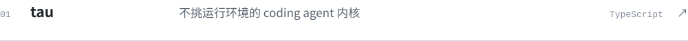
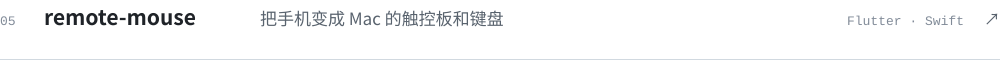

<picture><source media="(prefers-color-scheme: dark)" srcset="https://raw.githubusercontent.com/yophon/yophon/output/hero-dark.svg"></picture>

<a href="https://github.com/yophon/tau"><picture><source media="(prefers-color-scheme: dark)" srcset="https://raw.githubusercontent.com/yophon/yophon/output/row-tau-dark.svg"></picture></a>

<picture><source media="(prefers-color-scheme: dark)" srcset="https://raw.githubusercontent.com/yophon/yophon/output/row-gopan-dark.svg"></picture>

<a href="https://yophon.github.io/chewingdocs/"><picture><source media="(prefers-color-scheme: dark)" srcset="https://raw.githubusercontent.com/yophon/yophon/output/row-chewingdocs-dark.svg"></picture></a>

<a href="https://github.com/yophon/yo-agent"><picture><source media="(prefers-color-scheme: dark)" srcset="https://raw.githubusercontent.com/yophon/yophon/output/row-yo-agent-dark.svg"></picture></a>

<a href="https://github.com/yophon/remote-mouse"><picture><source media="(prefers-color-scheme: dark)" srcset="https://raw.githubusercontent.com/yophon/yophon/output/row-remote-mouse-dark.svg"></picture></a>

<a href="https://github.com/yophon/yophon-board"><picture><source media="(prefers-color-scheme: dark)" srcset="https://raw.githubusercontent.com/yophon/yophon/output/row-yophon-board-dark.svg"></picture></a>

<a href="https://979687.xyz"><picture><source media="(prefers-color-scheme: dark)" srcset="https://raw.githubusercontent.com/yophon/yophon/output/link-studio-dark.svg"></picture></a><a href="https://blog.979687.xyz"><picture><source media="(prefers-color-scheme: dark)" srcset="https://raw.githubusercontent.com/yophon/yophon/output/link-blog-dark.svg"></picture></a><a href="https://board.979687.xyz"><picture><source media="(prefers-color-scheme: dark)" srcset="https://raw.githubusercontent.com/yophon/yophon/output/link-board-dark.svg"></picture></a>
